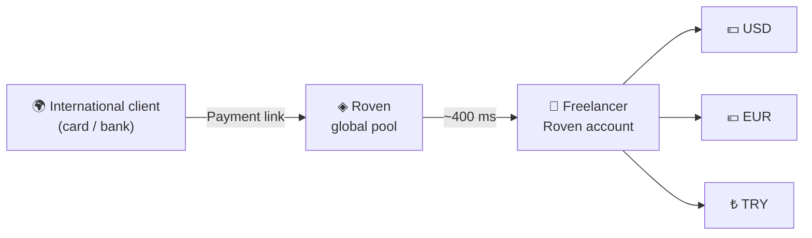

# Roven
Roven · onchain payouts for bankless freelancers
<div align="center">

# ◈ Roven

### Hold your money in any unit — no separate accounts needed.

**`onchain payouts for bankless freelancers`**

Turkish lira, dollars, euros, yen, gold and Bitcoin — **in one account**, settled in **~400 ms**.

<br/>


<br/>

[🇹🇷 Türkçe](README.tr.md) •
[✨ Features](#-features) •
[🚀 Quick Start](#-quick-start) •
[🧭 Screens](#-screens) •
[🌐 Global Payouts](#-global-payouts-freelancer-mode) •
[🛠️ Technical Details](#️-technical-details) •
[⚠️ Important Note](#️-important-note)

</div>

---

## 📖 What is Roven?

**Roven** is a **single-page multi-asset wallet interface** designed for freelancers who work with international clients, and for anyone who lives across multiple currencies.

The idea is simple: no separate account, separate IBAN or separate app for every currency. In one Roven account you hold **TRY, USD, EUR, JPY, gold (grams) and BTC** together, convert between them instantly, view your total in whichever unit you like, and collect payments from abroad with a single link.

> 💡 **Vision:** Let freelancers who don't have a bank — or are tired of dealing with one — get paid by clients on the other side of the world within seconds, through a clean and simple interface.

---

## ✨ Features

<table>
<tr>
<td width="50%" valign="top">

### 💱 Multi-Asset Account
6 different assets in one account:

| Asset | Type |
|:--|:--|
| ₺ Turkish Lira | Cash |
| $ US Dollar | Forex |
| € Euro | Forex |
| ¥ Japanese Yen | Forex |
| g Gold (gram) | Precious metal |
| ₿ Bitcoin | Crypto |

</td>
<td width="50%" valign="top">

### ⚡ Instant Transactions
- **~400 ms** settlement time
- **0.000001 unit** network fee
- Conversions highlighted as **zero commission**
- Unique **hash** recorded for every transaction
- Live **ms** indicator on every transfer

</td>
</tr>
<tr>
<td width="50%" valign="top">

### 📈 Live Market
- Scrolling **live market ticker** at the top
  (Gold, BTC, USD, EUR, JPY)
- Rates update periodically
- **Profit / loss** calculation per asset
- Portfolio **cost ↔ current value** table

</td>
<td width="50%" valign="top">

### 🛡️ Identity & Account
- Account opening with **Turkish ID / KYC**
- KYC Level 2 badge
- Profile & identity details modal
- Automatic account number generation (`RVN-TR..`)
- One-click account number copy

</td>
</tr>
<tr>
<td width="50%" valign="top">

### 🌐 Freelancer Mode
- Dedicated **Global Payouts** screen
- **Payment link** for international clients
- Request amounts in USD / EUR / TRY
- Live **overseas payment simulation**

</td>
<td width="50%" valign="top">

### 🎨 User Experience
- 🌙 / ☀️ **Dark & light theme**
- 🇹🇷 / 🇬🇧 **Turkish & English** interface
- 📱 Responsive design
- 🔔 Toast notifications
- 💾 Persistent data in the browser

</td>
</tr>
</table>

---

## 🚀 Quick Start

Roven is **a single HTML file**. No installation, no build step, no package manager.

### Option 1 · Just open it

```bash
git clone https://github.com/<your-username>/roven.git
cd roven
# open index.html in your browser
```

### Option 2 · Run a local server

```bash
# Python
python3 -m http.server 8080

# or Node.js
npx serve .
```

Then visit **http://localhost:8080** in your browser.

### Option 3 · Publish with GitHub Pages 🌍

1. Push the repository to GitHub
2. Go to **Settings → Pages**
3. Choose **Source:** `main` branch, `/ (root)`
4. In a few minutes your site will be live at `https://<your-username>.github.io/roven/`

---

## 🎮 Try the Demo

To try it right away without signing up, use the ready-made buttons on the login screen:

| Button | What it does |
|:--|:--|
| **⚡ Quick Start with Demo Balance** | Logs in with a pre-funded demo account (Ayşe Yılmaz) |
| **⚡ Demo Freelancer Login** | Logs in in freelancer mode (Can Berk · UI/UX Designer) |
| **Open Account (KYC)** | Creates a new demo account with your own details |

**Starting demo balance:**

| ₺ TRY | ₿ BTC | $ USD | € EUR | ¥ JPY | g Gold |
|:--:|:--:|:--:|:--:|:--:|:--:|
| 18,450 | 0.0125 | 820 | 240 | 35,000 | 12.4 |

---

## 🧭 Screens

After logging in, the left menu gives you access to 6 main screens:

### 🏠 Home
A large balance card showing your total portfolio value, where you can **switch the display unit with one click** (₺ / $ / € / ¥ / Au / ₿). Below it: daily inflow/outflow, portfolio FX gain, live rates, asset distribution and recent activity. Quick action buttons: **Send Money · Buy Bitcoin · Convert · Copy Account No**.

### 💼 Units
A table of **cost, current rate, current value and net change** for all your assets, with a separate card for each asset below it.

### 📤 Transfer
- **New Transfer:** Recipient name, `RVN-` Roven account number, unit, amount and note. Use the `MAX` button to select your entire balance in one click.
- **Saved Recipients:** Save people you send to often, pick them from the list with one click, or delete them.
- Your available balances are always visible in the side panel.

### 🔄 Convert
Pick the source and target unit, enter an amount, see the instant quote and convert **in ~400 ms**. Use `⇄` to swap units. Preset quick-buy buttons: **₺1,000 / ₺5,000 of Bitcoin · 1 g Gold · $100 Dollars**.

### 🌐 Global Payouts
A dedicated screen for freelancers. Details [below](#-global-payouts-freelancer-mode).

### 🧾 History
A table of all your transactions with time, description, unit, amount, confirmation time and **transaction hash**.

---

## 🌐 Global Payouts (Freelancer Mode)



1. **Share your link** — Send your personal `roven.me/pay/...` payment link to your client.
2. **Your client pays** — With their own card or bank, in their own currency.
3. **It lands in seconds** — The amount appears in your Roven account as USD, EUR or TRY.

The screen includes:

- 🔗 A copyable **payment link**
- 💱 Requested currency selection (USD / EUR / TRY)
- 📝 Service description field
- 🧪 **Overseas payment simulation:** With one click, receive a sample `$1,250` client payment (Apex Interactive LLC · San Francisco) into your account and see how the bridge works.

---

## 🛠️ Technical Details

### 🧱 Architecture

```
roven/
├── index.html      # The entire app: HTML + CSS + JavaScript
├── README.md       # This file (English)
└── README.tr.md    # Turkish version
```

There are **no** frameworks, compilers or package dependencies. Styles, logic and images (logo/favicon embedded as base64) all live in a single file.

### 🧰 Tech Stack

| Layer | Used |
|:--|:--|
| **UI** | Pure HTML5 + CSS3 (CSS variables, Grid, Flexbox) |
| **Logic** | Vanilla JavaScript (ES6+) |
| **Typography** | [Fraunces](https://fonts.google.com/specimen/Fraunces) (headings) · [Outfit](https://fonts.google.com/specimen/Outfit) (body) — Google Fonts |
| **Theming** | `data-theme` attribute + CSS variables |
| **Persistence** | `localStorage` (`roven-state-v7`) |
| **Language** | Built-in TR / EN translation layer |
| **FX data** | [open.er-api.com](https://open.er-api.com) (USD, EUR, JPY) + simulated fluctuation |

### 🎨 Design Language

| Color | Usage |
|:--|:--|
| 🟦 **Navy** `#0d2b4a` | Primary brand color, sidebar, primary buttons |
| 🟨 **Gold** `#c4a265` | Accent color, active menu, badges |
| 🟩 **Mint** `#1f8a6e` | Profit, incoming money, positive states |
| 🟥 **Coral** `#c4514a` | Loss, outgoing money, delete actions |

All colors for the light and dark themes are defined as CSS variables under `:root` and `[data-theme="dark"]`; to add a new theme, just duplicate those variables.

### 🔁 How It Works

- **Rates:** On load, the app tries to fetch real USD/EUR/JPY rates; if that fails (offline / CORS) it falls back to simulation seamlessly. Small fluctuations are applied to the rates every **5 seconds**.
- **Valuation:** All balances are first converted to their TRY equivalent, then to the selected display unit.
- **Profit / loss:** Calculated by comparing current rates against reference (baseline) rates.
- **State management:** All user data (balances, saved recipients, transactions, theme, display unit) lives in a single `state` object and is written to `localStorage` on every change.
- **Transaction hash:** A random Solana-style hash using the base58 character set is generated for each transaction (`AbCd...xYz1`).

### 🔄 Resetting Data

You can wipe all demo data from the reset option in the profile modal. To do it manually, run this in the browser console:

```js
localStorage.removeItem('roven-state-v7'); location.reload();
```

---

## ⚠️ Important Note

> **Roven is currently a UI prototype / demo.**
>
> - There is **no** real backend, database, bank or blockchain connection.
> - Balances, transfers, KYC verification, "onchain" transactions and the overseas payment flow are **entirely simulated**.
> - Any Turkish ID number, email and phone number you enter is stored **only in your own browser's `localStorage`** and is never sent anywhere.
> - Gold and Bitcoin rates and profit/loss figures are **for demonstration only** and are not investment advice.
> - **Do not** use it with real money, real identity information or real passwords.

---

## 🗺️ Roadmap

- [ ] 🔌 Real-time XAU and BTC price integration
- [ ] 🗄️ Backend and real user authentication
- [ ] ⛓️ Real onchain payment infrastructure integration
- [ ] 📊 Portfolio performance charts
- [ ] 🧾 Export transactions as CSV / PDF
- [ ] 🔔 Price alerts
- [ ] 📱 PWA support (add to home screen, offline use)
- [ ] 🌍 More languages and currencies

---

## 🤝 Contributing

Contributions are welcome! 💛

1. **Fork** the project
2. Create a new branch: `git checkout -b feature/awesome-feature`
3. Commit your changes: `git commit -m "feat: add awesome feature"`
4. Push your branch: `git push origin feature/awesome-feature`
5. Open a **Pull Request**

Use the **Issues** tab for bug reports and suggestions.

---

## 📄 License

This project is licensed under the [MIT License](LICENSE). See the `LICENSE` file for details.

---

<div align="center">

**◈ Roven** · *onchain payouts for bankless freelancers*

Every unit, from one source. One account, ~400 ms. ⚡

⭐ If you like the project, don't forget to leave a star!

</div>
